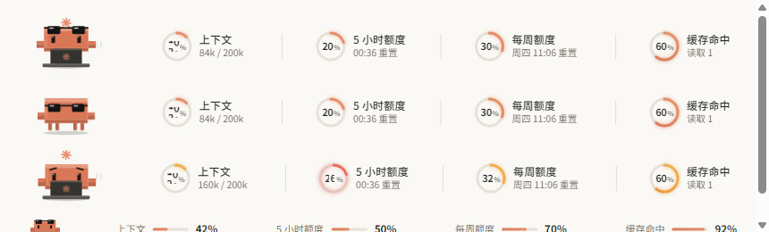

# claude-desktop-mods-light

**usage-pet 的浅色主题版 · A light-theme variant of usage-pet** — for the Code tab of Claude Desktop.

> 基于 [manson341349-beep/claude-desktop-mods](https://github.com/manson341349-beep/claude-desktop-mods)（MIT）修改，原版是深色主题。**非官方项目**，与 Anthropic 无关；Clawd 是 Anthropic 的吉祥物，这里是粉丝自制像素版。
> Derived from the original MIT-licensed dark-theme `usage-pet`. Unofficial; not affiliated with Anthropic.



## 改了什么 / What changed

- 文字、圆环底轨、分隔线、阴影、提示 chip 全部改成适合浅色背景的配色；`color-scheme` 由 `dark` 改为 `light`
- Clawd 配色与全部动画、功能保持原版不变（四项用量、自动折叠、中英双语、`/clawd` 切换…，详见原项目 README）
- 插件名为 `usage-pet-light`，状态 key 独立，可与深色版同时安装（建议只启用一个）

## 安装 / Install

```bash
claude plugin marketplace add chinayuren2022-2025/claude-desktop-mods-light
claude plugin install usage-pet-light@claude-desktop-mods-light
```

然后在会话里输入 `/reload-plugins`。更新：`claude plugin update usage-pet-light@claude-desktop-mods-light`；卸载：`claude plugin uninstall usage-pet-light@claude-desktop-mods-light`。

要求与已知限制同原版：Claude 桌面 App 的 Code 页，Claude Code 2.1.287+。
